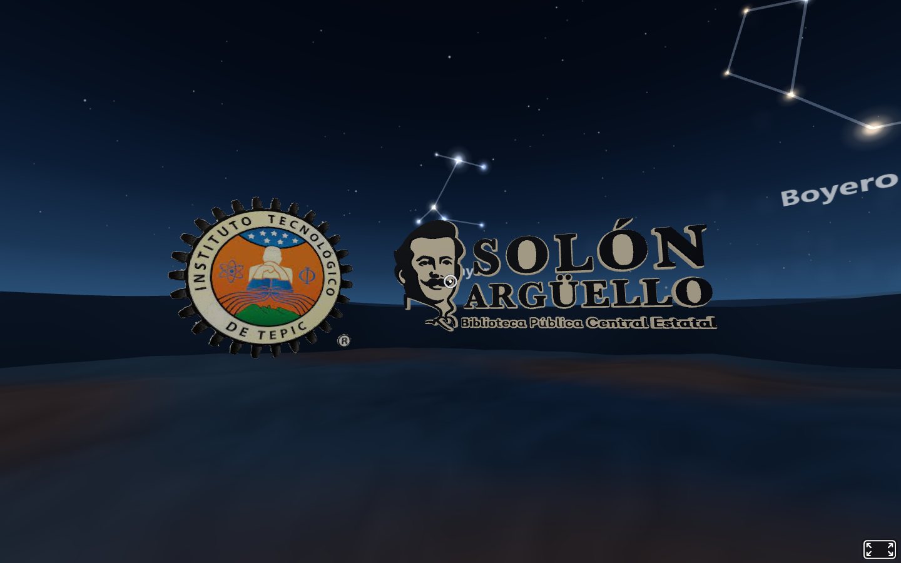
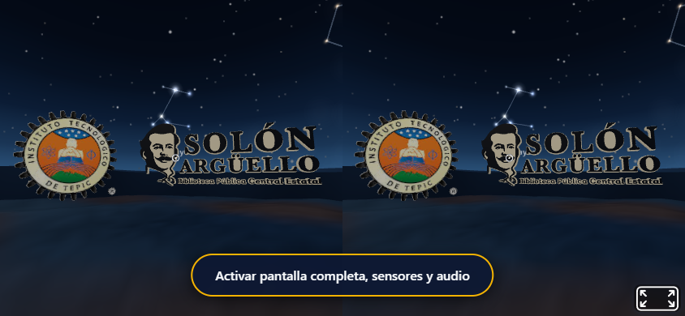

# Logos institucionales en relieve

Cambio OpenSpec: `logos-institucionales-relieve-3d`. Plan aprobado en el chat, incluidos tamaños mayores e independientes. Base revisada: `b5f1c00`; rama `feat/logos-institucionales-relieve-3d`. Entrega mediante PR hacia `main`, sin merge ni archivado de OpenSpec.

## Resultado implementado

IT Tepic y Biblioteca Pública Central Estatal Solón Argüello se representan mediante contornos extruidos, con caras laterales y detalles a distinta profundidad. Se retiraron del visor las imágenes planas anteriores y CECAN. La web 2D conserva sus recursos y código de identidad.

El grupo está fijo en `0 2.3 5`, rotado 180 grados; la cámara inicial está en `0 1.6 0`. El ancho de referencia de Tepic es 2.6 unidades y el de biblioteca 5.2. Cada emblema se orienta hacia el visitante y conserva las proporciones de su fuente. El grupo es hermano de los controles, sin objetivos seleccionables. Su iluminación puntual no requiere sombras.

Tepic tiene siete capas y 22 016 triángulos. Sus caras usan el JPG original como mapa de color sobre la geometría; esto conserva los detalles de la fuente y no sustituye el relieve por un plano. Biblioteca tiene dos capas y 17 556 triángulos: soporte marfil recortado alrededor del retrato y las letras, y tinta negra elevada. El soporte rellena el rostro y los interiores de las letras; no es un cartel rectangular. Total: nueve mallas, 39 572 triángulos, sin dependencias nuevas en la aplicación.

## Fuentes y reproducción

- Tepic: adjunto `C:/Tec/ITTepic_logo.jpg`, idéntico al archivo ya versionado `frontend/public/ITTepic_logo.jpg`. SHA-256 `71e6952ec7d6dd41e113f4a9268ae50e32792cd117013394cc5b25fa866c8c91`.
- Biblioteca: PNG adjunto del usuario, conservado en `frontend/public/prueba-homido/logos/fuentes/biblioteca-solon.png`. Su hash está en `biblioteca.json`.
- Los JSON contienen los contornos, huecos, dimensiones de fuente y profundidades. No se inventaron textos ni se sustituyeron por otra tipografía.
- Preparación offline verificada con Python, OpenCV 5.0.0 y NumPy 2.5.4 instalados en una carpeta temporal; no forman parte del runtime web. Con estas herramientas disponibles: `python scripts/generar-relieves.py frontend/public/ITTepic_logo.jpg frontend/public/prueba-homido/logos/fuentes/biblioteca-solon.png`. El script incluye comprobaciones de contorno exterior, hueco y máscara vacía.

## Verificación real

- Referencia anterior al cambio, fuera del sandbox: frontend 176/176 y backend 145/145.
- Verificación final: `npm run test:web`, 176/176; `npm test`, 145/145; `npm run build`, completado.
- `openspec validate logos-institucionales-relieve-3d --strict` y `git diff --check`: sin errores.
- Se observaron primero los dos fallos esperados de las aserciones nuevas de identidad y luego sus nueve pruebas en verde. También se observó fallar la aserción de mapa de color antes de incorporarlo a las caras del relieve.
- `node scripts/verificar-relieves-3d.cjs`: Chrome headless sobre el build servido con API y catálogo temporales. Pantalla 1440 × 900 y estéreo simulado 844 × 390. Sin excepciones JavaScript en la ejecución final.
- La prueba geométrica usa Three.js real: profundidad 0.1, rayo que atraviesa el hueco sin impacto y rayo que impacta la superficie sólida; liberación de geometría, dos materiales y textura.
- Carga 404 aislada sin retirar los otros emblemas, cámara disponible y cancelación durante carga sin reinsertar geometría.
- Apertura y cierre de ficha; estados reales `reproduciendo` y `pausado` del narrador tras gestos separados; emblemas fijos; modo estéreo activo y salida al inicio.
- Todos los vértices de ambos emblemas están dentro del encuadre de cada ojo para la orientación posterior probada. Máximo horizontal normalizado observado: 0.932; el borde del encuadre es 1. La primera prueba detectó recorte de Tepic, que se corrigió ajustando posición y distancia sin reducir su escala.
- Revisión independiente de código y evidencias: sin hallazgos bloqueantes; sus nueve pruebas enfocadas pasaron.

## Incidencias durante las comprobaciones

El sandbox impidió enlaces temporales de las pruebas existentes (`EPERM`); las suites se ejecutaron fuera de él. En una ejecución final de backend fallaron `POST con portada existente del mismo ID crea registro demo y relación en una transacción` (503 frente a 201) y `CLI operacion: distingue intervención de limpieza de restauración no confirmada` (`EPERM` al renombrar un archivo temporal). La repetición completa terminó 145/145. No se modificó código de backend.

El servidor de pruebas dejaba sin consumir la respuesta inicial de su consulta de catálogo y Node 24/Undici abortaba al cerrar conexiones. Se reprodujo el fallo, se comprobó que consumir la respuesta lo evitaba y se añadió `await response.arrayBuffer()` al helper compartido, tras revisar sus llamadores. El primer bloque asíncrono de automatización de audio no alcanzó reproducción; con Activar y Escuchar en evaluaciones de navegador separadas se observaron reproducción y pausa, sin modificar el reproductor.

## Evidencias y límites

Las capturas y mediciones están en [evidencias-relieves-3d](evidencias-relieves-3d/resultados.json): entrada, vista posterior, vista oblicua y estéreo. Las dimensiones de las cajas del informe son ejes del mundo e incluyen el giro de cada emblema; no son medidas de su espesor local.

No se probó Homido físico, teléfono real ni escucha humana en esta tarea. La comodidad, lectura de inscripciones pequeñas y rendimiento en hardware real siguen pendientes. El JPG de Tepic tiene 225 × 225 píxeles; el relieve no recupera detalle ausente en esa fuente. Las capturas prueban el encuadre en esos viewports, no en todos los teléfonos y campos visuales de visores.
