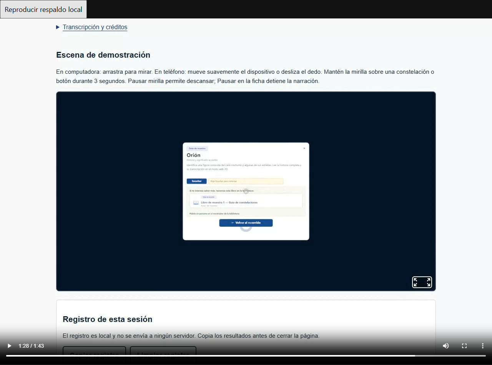

# Adaptación web de AstroVisor para computadora y pantalla

Informe de resultados del Sprint 4

**Responsable:** Luis Alberto Rodríguez · **Equipo:** 8

**Materia:** Taller de Full Stack · **Proyecto:** AstroVisor

**Periodo base:** 2–6 de noviembre de 2026 · **Registro técnico:** 9–10 de noviembre de 2026

## Mi aportación al Sprint 4

Mi parte del sprint quedó terminada: adapté el recorrido público de AstroVisor para computadora y pantalla, preparé el respaldo audiovisual y reuní las evidencias. Se conservan las historias y narraciones de Orión, Osa Mayor y Escorpio, disponibles sin cuenta ni visor.

Reutilicé la identidad visual, las fichas y los controles de S2 y S3. Añadí una vista para proyección que amplía el texto y reorganiza el contenido. El informe documenta mi aportación a la presentación y demostración del equipo.

## Objetivo e historia de usuario

La historia de usuario fue: «Como visitante quiero utilizar la experiencia web desde una computadora o proyector». Busqué facilitar la lectura y la operación con teclado o ratón, manteniendo la experiencia 2D sin Homido.

El periodo base fue el 2–6 de noviembre y el registro técnico se realizó los días 9 y 10. Las evidencias corresponden a estas últimas fechas y no acreditan actividades de la Expo del 5.

## Criterios de aceptación y resultados

| Criterio | Resultado de mi entrega |
|---|---|
| Computadora y pantalla | Vista para proyección y distribución adaptable en inicio, listado y ficha. |
| Experiencia 2D sin visor | Lectura, narraciones y créditos disponibles en el recorrido público. |
| Accesibilidad y operación | Texto ampliado, foco visible, salto al contenido y uso con teclado y ratón. |
| Evidencia verificable | Suites aprobadas, 44 casos de navegador y 6 comprobaciones de zoom nativo. |
| Contenido y acceso | Rótulos demostrativos, autoría y créditos conservados; ajuste limitado al recorrido público. |
| Revisión cruzada | Conformidad de Índigo Ortiz registrada como reporte del responsable. |

## Cambios realizados

### Vista para proyección y distribución del contenido

Añadí el control **Vista para proyección** en el recorrido público. El botón muestra si la opción está activada y comunica ese estado a las tecnologías de asistencia. La elección se conserva al pasar del inicio al listado y a una ficha dentro de la aplicación. Al recargar la página se recupera la vista habitual.

La vista amplía el cuerpo principal a aproximadamente **24 px** y permite un contenedor de hasta **1440 px**. Las columnas se reorganizan según el espacio disponible y el texto mantiene un ancho de lectura acotado. Esto permite aprovechar una pantalla grande sin convertir cada párrafo en una línea excesivamente larga.

Conservé el fondo claro, la tinta oscura y el azul del diseño anterior, además de los títulos Georgia y el texto de interfaz del sistema. El ajuste se aplica a las páginas públicas; no modifica el panel administrativo ni amplía automáticamente los elementos internos del lienzo 3D.

*Figura 1. Inicio público con la vista para proyección activada. Captura de navegador a 1920 px; muestra la distribución web y no constituye una fotografía de proyector.*

### Teclado y continuidad de la experiencia

Conservé el foco visible y el salto al contenido principal. Los controles nuevos tienen un tamaño mínimo de 48 px. Verifiqué Tab y Mayús+Tab, la activación con Enter o Espacio y el uso con ratón, incluyendo narraciones, créditos y regreso entre páginas.

Las tres historias mantienen lectura sin sonido. Escuchar, Pausar y Reanudar conservan su funcionamiento, y salir de una ficha detiene la narración. La adaptación reutiliza el contenido de S3 y mantiene la operación a ritmo del visitante.

## Pruebas y resultados

La verificación técnica se realizó en Windows con Chrome 157 sobre la compilación de S4. Se combinaron pruebas automatizadas, recorridos de navegador y revisión visual de capturas. Los registros distinguen las comprobaciones observadas de los fallos provocados para verificar recuperación.

| Comprobación | Resultado registrado |
|---|---|
| Backend mediante npm test | 7 de 7 pruebas aprobadas. |
| Frontend mediante npm run test:web | 26 de 26 pruebas aprobadas. |
| Compilación del frontend | Build correcto. |
| Regresión de navegador | 44 casos correctos, 0 fallos y 0 errores JavaScript de página. |
| Distribución adaptable | 30 combinaciones de ruta, ancho y vista sin desbordamiento horizontal. |
| Zoom nativo de Chrome al 200 % | 6 de 6 combinaciones aprobadas. |
| Video local sin conexión | Reproducción completa y pista de audio verificada. |

### Tamaños de pantalla y operación

La matriz cubrió inicio, listado y ficha con anchos de **360, 1024, 1280, 1920 y 2560 px**, en vista habitual y para proyección. Incluyó los formatos 1024×768 y 1920×1080. Se comprobó que el contenido permaneciera dentro del ancho disponible y que los controles se acomodaran sin impedir la lectura vertical.

La regresión incluyó las tres constelaciones, historial, créditos, salto al contenido y persistencia de la vista al navegar. Con los WAV reales se observó avance del tiempo, pausa, reanudación y detención al abandonar la ficha. La salida de sonido de una sala depende de su equipo.

### Ampliación y recuperación ante fallos

El zoom nativo se cambió con los controles reales de Chrome hasta **200 %**. Inicio, listado y ficha aprobaron en ambas vistas sin desbordamiento horizontal. En las fichas se operaron audio y créditos mediante teclado conservando el foco. Esta prueba se registró separada de otras seis comprobaciones que duplicaron el texto mediante CSS.

También se provocaron una respuesta 503 de la API, un archivo de audio ausente y la falta de A-Frame, biblioteca de la escena 3D. Se verificó el reintento, la lectura conservada y el regreso a 2D, respectivamente. La API administrativa rechazó el acceso sin sesión con 401; no se utilizó una sesión real de Supabase en esta regresión.

## Materiales de mi entrega

### Video local de respaldo

Preparé un video de **103.551 segundos**, aproximadamente **1 minuto 44 segundos**, a **1280×900**, en formato WebM con imagen VP8 y audio Opus. Se conserva entre las evidencias y no se descarga automáticamente al abrir la web.

La imagen proviene de una grabación real del navegador. La pista de voz se editó a partir de los WAV de S3 y se alineó con los eventos de reproducción y pausa. El material muestra las tres historias, sus narraciones y créditos, la escena 3D, la vista dividida experimental y el retorno a 2D. La parte del visor se capturó en escritorio.

*Figura 2. Reproducción local del respaldo audiovisual. La escena se grabó en computadora y no acredita una captura desde Homido físico.*

El archivo se reprodujo completo en Chrome con la conexión deshabilitada, a velocidad normal y sin error de medio. El registro contabilizó **2589 fotogramas** y verificó una pista de audio decodificable con señal no nula. No se grabaron micrófono, sonido del sistema ni audio de una sala.

### Guía y alternativas durante la demostración

La guía indica cómo abrir el recorrido público, activar Vista para proyección y mostrar una historia con sus controles. Si la escena 3D no está disponible, se continúa en 2D. Si falla la red necesaria para la web, se abre el archivo audiovisual local como respaldo del recorrido completo.

La experiencia web requiere que sus servicios y recursos sean accesibles. El recurso comprobado sin conexión es el video. El equipo expone con una presentación y la demostración del proyecto; no se exige un ensayo cronometrado separado como parte de mi entrega personal.

## Validación y revisión cruzada

Confirmé que **Homido y pantalla ya fueron revisados y funcionan correctamente**. La constancia se recibió el 10 de noviembre y se conserva como mi reporte de funcionamiento. No quedaron especificados el modelo de pantalla o proyector, la computadora, la fecha exacta de ejecución ni la versión utilizada; el informe no atribuye condiciones físicas que no estén registradas.

También confirmé que **Índigo Ortiz revisó S4 y lo considera correcto**, sin incidencias comunicadas. Esta es la revisión nueva de este sprint. Se registra como conformidad comunicada por mí, sin atribuir una revisión formal desde su cuenta de GitHub.

La adaptación aporta texto más grande, controles visibles y operación por teclado, relevantes para el público adulto mayor del proyecto. Los contrastes calculados en pantalla fueron 14.63:1 para el texto principal y 6.16:1 para el secundario sobre el fondo claro. Estas medidas digitales no certifican legibilidad a distancia bajo luz ambiente ni una evaluación formal con personas adultas mayores.

## Evidencias y archivos de consulta

Estos materiales permiten revisar los resultados desde la carpeta del proyecto. Las capturas de este informe acompañan los registros completos y no sustituyen las constancias de las pruebas físicas.

- [Registro técnico de S4 y resultados por comprobación](../astrovisor-s1-inicio/docs/PRUEBA-S4.md).
- [Guía de uso y demostración para computadora y pantalla](../astrovisor-s1-inicio/docs/GUIA-S4-EXPO.md).
- [Resultados de los 44 casos de navegador](../astrovisor-s1-inicio/docs/evidencias/s4/navegador.json).
- [Registro del zoom nativo al 200 por ciento](../astrovisor-s1-inicio/docs/evidencias/s4/zoom-nativo.json).
- [Video local de respaldo](../astrovisor-s1-inicio/docs/evidencias/s4/astrovisor-respaldo-s4.webm).
- [Constancias de Homido y pantalla y revisión de Índigo](../astrovisor-s1-inicio/docs/evidencias/s4/validacion-reportada.json).
- [Autoría de los contenidos y permisos de uso](../astrovisor-s1-inicio/content/AUTORIA.md).

Los relatos siguen identificados como demostrativos y mantienen la autoría colectiva del equipo. La voz sintética reutilizada de S3 conserva la identificación de Kokoro, con licencia Apache 2.0 del modelo y MIT del runtime. No se añadió material institucional de biblioteca ni una autorización nueva sobre los textos.

## Estado de mi parte

Mi parte de S4 está terminada, con implementación, respaldo audiovisual, evidencias técnicas y revisión cruzada reportada. AstroVisor permite mostrar el recorrido público desde computadora y activar una distribución preparada para pantalla grande, manteniendo lectura, narraciones y regreso a 2D. Este cierre corresponde a mi entrega individual y no acredita la realización de la Expo ni una publicación en producción.
