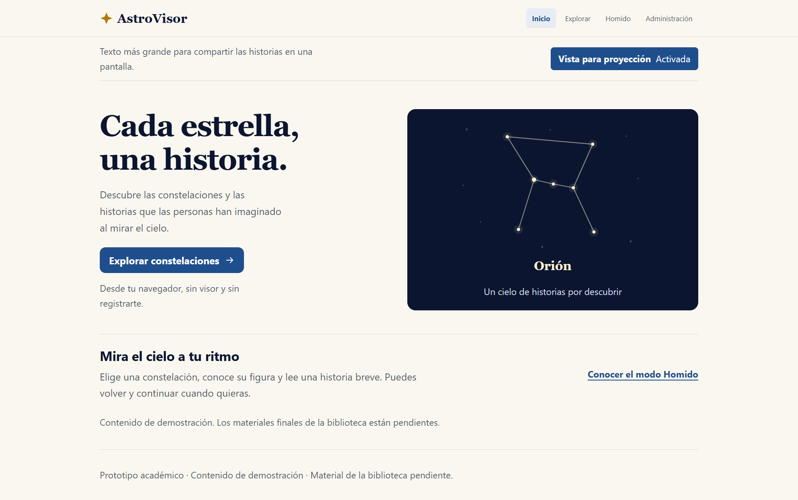

# AstroVisor desde computadora y pantalla

Informe de resultados del Sprint 4

| Dato | Registro |
|---|---|
| Proyecto | AstroVisor |
| Equipo | 8 |
| Materia | Taller de Full Stack |
| Responsable | Luis Alberto Rodríguez |
| Periodo académico base | 2–6 de noviembre de 2026 |
| Implementación y verificación técnica registradas | 9–10 de noviembre de 2026 |
| Fecha del informe | 10 de noviembre de 2026 |
| Estado | Trabajo técnico concluido; revisión cruzada de Índigo reportada como correcta. Ensayo cronometrado pendiente por decisión del responsable. |
| Revisión cruzada reportada | Índigo Ortiz; conformidad comunicada por Luis el 10 de noviembre de 2026. |

## Objetivo y alcance de mi participación

La historia de usuario fue: «Como visitante quiero utilizar la experiencia web desde una computadora o proyector».

Adapté el recorrido público existente para facilitar su uso en computadora y en una pantalla compartida. Incorporé una vista para proyección con texto mayor, distribución adaptable y controles accesibles. Se conserva la visita sin registro y sin visor: inicio, listado de constelaciones, lectura, narración y regreso.

La entrega incluye una guía de operación, un guion de presentación de cinco minutos, evidencias de pruebas y un video local de respaldo. Las historias, ilustraciones y narraciones de Orión, Osa Mayor y Escorpio se reutilizaron de los incrementos anteriores; S4 no produjo nuevas voces ni cambió los relatos.

El periodo base se conserva como planificación académica. La implementación y las pruebas técnicas aquí descritas se registraron el 9 y 10 de noviembre; no se presentan como actividades realizadas durante la Expo del día 5. La confirmación de funcionamiento de Homido y pantalla se recibió el 10 de noviembre, sin fecha de ejecución especificada.

## Resultado para el visitante

El botón **Vista para proyección** permite alternar entre la vista habitual y una presentación con cuerpo principal de aproximadamente 24 px. Su estado se muestra como Activada o Desactivada y también se comunica mediante el estado accesible del botón. La elección continúa al navegar entre inicio, listado y fichas; una recarga completa vuelve a la vista habitual.

El contenido se reorganiza según el espacio disponible. La lectura puede continuar mediante desplazamiento vertical, con ancho de texto limitado, botones grandes y foco visible. El salto al contenido permite omitir la navegación con teclado. Los controles de audio conservan Escuchar, Pausar y Reanudar, transcripción y créditos.

La adaptación se aplica al recorrido público 2D. El visitante sigue entrando sin cuenta; el acceso administrativo conserva su protección en el servidor. No se incorporaron cambios al mecanismo de mirada ni a la óptica del visor.

*Captura del build en un viewport de 1920 px. Comprueba distribución en navegador; no documenta por sí sola un proyector físico.*

## Criterios de aceptación y resultados

| Criterio | Resultado y evidencia |
|---|---|
| Uso desde computadora sin visor | Recorrido público, lectura y narración operables con teclado y ratón. Verificación de navegador registrada. |
| Adaptación a pantalla y texto mayor | Vista para proyección disponible. Comprobación entre 360 y 2560 px, incluyendo 1024×768 y 1920×1080. |
| Teclado y ampliación | Navegación, audio, créditos e historial comprobados. Zoom nativo al 200 % aprobado en las tres vistas, en modo habitual y proyección. |
| Contingencia 2D | La salida del visor permite regresar a las historias web cuando el frontend, la API y los recursos están disponibles. |
| Respaldo local | Video WebM reproducido completo desde archivo local con el navegador sin conexión. Pendiente comprobar ese archivo en el equipo específico de ensayo. |
| Homido y pantalla reales | Reporté que ambos ya fueron revisados y funcionan correctamente. Los detalles no especificados permanecen identificados como tales. |
| Evidencias y revisión cruzada | Capturas, logs, registros y hashes disponibles. Índigo revisó S4 y lo considera correcto, según la confirmación del responsable. |
| Contenido provisional y acceso | Se conservan rótulos de demostración, créditos y voz sintética; la visita pública no requiere credenciales. |

## Pruebas técnicas

| Comprobación | Resultado registrado |
|---|---|
| Pruebas del backend | 7 de 7 aprobadas. |
| Pruebas del frontend | 26 de 26 aprobadas. |
| Build del frontend | Compilación correcta. |
| Regresión de navegador | 44 casos correctos y 0 fallos. Incluye 30 combinaciones de ruta, vista y tamaño, seis simulaciones de texto ampliado y recorridos funcionales. |
| Zoom nativo al 200 % | 6 de 6 combinaciones aprobadas: inicio, listado y ficha, en ambas vistas. |
| API administrativa sin sesión | Denegación con HTTP 401; no se necesitó una sesión administrativa para la demostración pública. |

La regresión del 9 de noviembre utilizó Chrome 157.0.8103.38 en Windows. La prueba de zoom nativo del 10 de noviembre utilizó Chrome 157.0.8103.50 sobre el mismo build. El zoom se cambió desde los controles reales del navegador, comprobando su indicador al 200 % y el factor de escala relativo. No se contabilizó la ampliación CSS como zoom nativo.

Se verificaron pausa, reanudación y detención de los tres audios al abandonar la ficha. También se indujeron fallos controlados: API no disponible y recuperación por reintento, archivo de audio ausente conservando la lectura, y A-Frame bloqueado con retorno a 2D. Estas incidencias son escenarios de prueba, no fallos observados espontáneamente en los dispositivos del equipo.

El cuerpo principal de proyección se midió a 24.0012 px y el control nuevo cumple una altura mínima de 48 px. Se mantuvo el ancho del documento sin desplazamiento horizontal. La evaluación de contraste en pantalla registró 6.16:1 para texto secundario sobre el fondo y 8.31:1 para azul sobre blanco. Esas mediciones no equivalen a contraste bajo la luz de una sala ni a una evaluación formal con personas adultas mayores.

Evidencias: [regresión de navegador](../astrovisor-s1-inicio/docs/evidencias/s4/navegador.json), [zoom nativo](../astrovisor-s1-inicio/docs/evidencias/s4/zoom-nativo.json), [indicador del navegador al 200 %](../astrovisor-s1-inicio/docs/evidencias/s4/zoom-200-chrome.png) y [controles de audio y créditos con zoom](../astrovisor-s1-inicio/docs/evidencias/s4/zoom-200-ficha-proyeccion-controles.png).

## Respaldo y presentación

El [video local de respaldo](../astrovisor-s1-inicio/docs/evidencias/s4/astrovisor-respaldo-s4.webm) dura **103.551 segundos**, tiene resolución **1280×900** y contiene video VP8 y audio Opus. Resume inicio, activación de proyección, tres historias con sus narraciones, pausa/reanudación, créditos, escena 3D, vista dividida experimental y retorno a 2D.

La imagen es una grabación real del build en Chrome de escritorio. La pista de voz se editó a partir de los WAV de S3, alineados con los eventos de reproducción registrados. No es grabación de micrófono, sonido de sala ni visor físico. Se conserva la identificación de voz sintética y contenido demostrativo. Los permisos y la procedencia de las narraciones continúan documentados en [AUTORIA.md](../astrovisor-s1-inicio/content/AUTORIA.md).

El archivo se reprodujo completo mediante una dirección local `file://`, con el navegador en modo sin conexión desde antes de abrirlo. Se comprobaron 2589 frames, ausencia de error del medio y una pista de audio decodificada con señal no nula. Esta prueba no sustituye la comprobación de volumen y reproducción en el equipo que se utilizará en la sala. Ver [registro de reproducción local](../astrovisor-s1-inicio/docs/evidencias/s4/video-local.json).

La [guía de presentación](../astrovisor-s1-inicio/docs/GUIA-S4-EXPO.md) contiene el guion de cinco minutos y las contingencias: continuar en 2D si falla el visor y abrir el video local si falla la red necesaria. La ruta web 2D requiere sus servicios y recursos accesibles; el respaldo sin red es el archivo audiovisual. Proyectar la escena no sustituye la validación con visor real.

## Confirmación de Homido y pantalla

El 10 de noviembre confirmé en el chat de trabajo que «el homido el homido y la pantalla ya lo revisamos, funciona correctamente». Esa declaración se registró como resultado funcional correcto reportado por el responsable, tanto para Homido como para pantalla.

La constancia de hardware no especifica fecha de ejecución, teléfono, computadora, navegador, modelo de pantalla/proyector, resolución, enlace ni participantes. Tampoco desglosa pruebas de sonido, red o video sin conexión en ese equipo. Esos datos no se completaron por suposición. Ver [constancia del reporte](../astrovisor-s1-inicio/docs/evidencias/s4/validacion-reportada.json).

## Revisión cruzada

Posteriormente confirmé que **Índigo Ortiz revisó S4 y dice que está bien**, mediante el mensaje «indigo ya lo reivozo y dice que esta bien». Su conformidad queda registrada como revisión cruzada reportada por el responsable, sin incidencias comunicadas. La fecha de esta constancia es el 10 de noviembre; no se especificaron fecha exacta de revisión ni versión revisada. Esta confirmación corresponde a S4 y no reutiliza la aprobación de S3 ni representa una revisión formal de GitHub.

## Estado de entrega y pendientes

El trabajo técnico actual está concluido y preparado en la rama `codex/s4-web-computadora-proyeccion`; su integración en `main` sigue pendiente. La versión y los archivos verificados están identificados mediante el [manifiesto de evidencias](../astrovisor-s1-inicio/docs/evidencias/s4/version.json).

Por mi indicación, el ensayo cronometrado de cinco minutos se deja pendiente, sin fecha comprometida. También queda abierto completar los detalles disponibles de las pruebas de Homido/pantalla ya reportadas correctas y comprobar el respaldo sin red en el equipo específico de ensayo. Estos pendientes no se presentan como resultados aprobados ni como participación realizada en la Expo.

El alcance entregado permite usar y demostrar el recorrido web desde computadora, ampliar la presentación para pantalla y disponer de una contingencia audiovisual verificable. El [registro técnico completo](../astrovisor-s1-inicio/docs/PRUEBA-S4.md) conserva los resultados, métodos y límites de cada comprobación.
